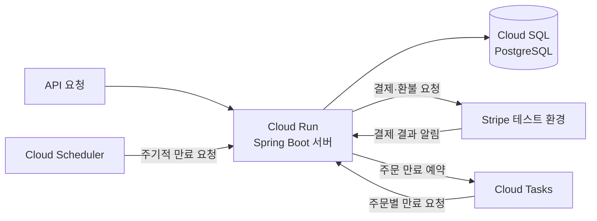

# 온라인 서점 서버

도서 검색, 장바구니, 주문, 결제와 환불 기능을 구현한 온라인 서점 REST API 서버입니다.
API와 DB 설계, 서버 구현, 테스트, Google Cloud 배포를 혼자 진행했습니다.

| 항목 | 내용 |
| --- | --- |
| 개발 기간 | 2026.07 ~ 2026.08 |
| 개발 인원 | 1명 |
| 담당 범위 | API·DB 설계, 서버 구현, 테스트, Docker 구성, 자동 배포 |
| 프로젝트 범위 | 프론트엔드 없이 서버를 구현한 개인 학습 프로젝트 |

결제와 환불은 Stripe 테스트 환경에서 연동했습니다.

**[API 문서 보기](https://hbg1345.github.io/book-server/)**

## 주요 기능

| 구분 | 구현 내용 |
| --- | --- |
| 회원·인증 | 회원 가입, 로그인, 토큰 발급·갱신, 사용자·관리자 권한 구분 |
| 도서·저자 | 도서 목록·상세 조회, 제목 검색, 관리자용 도서·저자 관리 |
| 장바구니 | 도서 추가, 수량 변경, 항목 삭제 |
| 주문 | 주문 생성·조회, 주문 당시 가격·배송지 보존, 취소·부분 취소 |
| 결제 | Stripe 결제 요청, 웹훅을 통한 결과 반영, 환불 |
| 주문 만료 | 미결제 주문의 만료 예약, 예약 누락에 대비한 주기적 만료 처리 |

## 기술 스택

| 구분 | 사용 기술 |
| --- | --- |
| 언어·서버 | Java 17, Spring Boot, Spring MVC |
| 인증 | Spring Security, JWT |
| 데이터 | PostgreSQL, MyBatis, Flyway |
| 외부 연동 | Stripe, Google Cloud Tasks, Cloud Scheduler |
| 실행·배포 | Docker, Docker Compose, GitHub Actions, Google Cloud Run, Cloud SQL |
| 테스트·문서 | JUnit, Mockito, MockMvc, Testcontainers, Spring REST Docs, OpenAPI, Swagger UI |

## 서버 구조

회원, 도서, 장바구니, 주문, 결제 기능을 하나의 Spring Boot 애플리케이션으로 구성했습니다.
요청을 받는 Controller, 업무 처리를 담당하는 Service, DB에 접근하는 MyBatis Mapper의 책임을 나누었습니다.



로컬에서는 Docker Compose로 서버와 PostgreSQL을 함께 실행합니다.
DB 스키마 변경과 초기 도서 데이터 적재는 Flyway로 관리합니다.

## 설계 과정에서 고민한 점

### 1. 주문의 현재 상태와 변경 이력 분리

주문 목록에서는 현재 상태를 빠르게 확인하고, 문제가 생겼을 때는 과거의 처리 과정을 확인할 수 있어야 했습니다.
따라서 주문별 현재 상태와 변경 이력을 나누어 저장했습니다.
두 기록이 서로 어긋나지 않도록 현재 상태 갱신과 이력 저장을 하나의 트랜잭션으로 처리했습니다.
주문 당시 가격과 배송지도 별도로 저장해 이후 도서 가격이나 회원 주소록이 바뀌어도 주문 정보를 유지하도록 했습니다.

### 2. 같은 장바구니의 중복 주문과 재고 경쟁 제어

같은 장바구니로 주문 요청이 동시에 들어오면 주문이 두 번 생성될 수 있습니다.
주문 처리에 앞서 해당 회원의 장바구니 항목을 잠그고, 주문 저장과 장바구니 비우기를 하나의 트랜잭션으로 처리했습니다.
뒤의 요청은 앞선 처리가 끝난 뒤 장바구니가 비어 있음을 확인하므로 추가 주문을 만들지 않습니다.

서로 다른 회원이 같은 책을 주문하는 경우에는 재고를 별도로 제어했습니다.
재고 차감 조건이 간단하여 DB에서 남은 수량을 확인하고 차감하는 조건부 갱신을 선택했습니다.
조회한 재고를 Java에서 확인한 뒤 갱신하는 절차를 나누지 않고, 재고가 충분할 때만 차감하도록 구성했습니다.

관련 코드: [주문 처리](src/main/java/com/example/bookserver/purchase/PurchaseService.java) · [동시 주문 테스트](src/test/java/com/example/bookserver/purchase/PurchaseConcurrencyTest.java)

### 3. 결제 재요청과 비동기 결과 반영

외부 결제 요청은 응답을 받지 못했다고 해서 실패했다고 단정할 수 없습니다.
같은 주문의 재요청을 구분할 수 있도록 주문 번호를 바탕으로 고정된 요청 식별값인 멱등성 키를 사용했습니다.
결제 결과는 Stripe가 보내는 알림인 웹훅으로 반영하며, 서명과 결제 금액·통화를 확인하도록 했습니다.

미결제 주문은 Cloud Tasks에 주문별 만료 작업을 예약했습니다.
주문 저장과 예약 등록은 별도 시스템에서 처리되므로, 예약이 누락되더라도 기한이 지난 주문을 정리할 수 있도록 Cloud Scheduler의 주기적 조회를 함께 구성했습니다.

관련 코드: [결제 연동](src/main/java/com/example/bookserver/payment) · [Stripe 테스트 환경 연동 검증](src/test/java/com/example/bookserver/payment/stripe/StripeSandboxContractTest.java)

## 테스트와 자동 배포

Testcontainers로 PostgreSQL을 실행해 DB를 포함한 테스트 환경을 구성했습니다.
재고 경쟁, 같은 장바구니의 중복 주문 등 동시 요청에서 발생할 수 있는 상황을 테스트했습니다.
일반 테스트에서는 외부 결제 호출을 대역으로 교체하고, Stripe 테스트 환경을 호출하는 테스트는 별도로 분리했습니다.

GitHub Actions에서 테스트와 API 문서 생성을 자동화했습니다.
기본 브랜치에 코드가 반영되고 테스트를 통과하면 Docker 이미지를 빌드해 Google Cloud Run에 배포합니다.
운영 DB는 Cloud SQL의 PostgreSQL을 사용하고, 생성한 API 문서는 GitHub Pages에 게시합니다.

관련 설정: [자동 배포 워크플로](.github/workflows/ci.yml) · [Docker 구성](Dockerfile) · [로컬 실행 구성](docker-compose.yml)

## 배운 점과 개선 방향

서버의 기능별 책임을 나누고, 데이터의 관계와 변경 이력을 설계하며, 개발·테스트·배포 파이프라인을 구성했습니다.
온라인 서점의 기본 기능을 구현하는 과정에서도 동시 주문, 재고 경쟁, 외부 결제 결과의 지연처럼 데이터 정합성을 고려해야 하는 상황이 많다는 점을 배웠습니다.

현재는 프론트엔드와 실제 사용자가 없어 실제 이용 과정에서 발생하는 문제를 확인하지 못했습니다.
또한 별도의 검증 환경 없이 자동 테스트를 통과한 코드를 운영 환경에 배포하는 구조입니다.
이용 흐름과 부하를 바탕으로 병목을 확인하고, 배포 전 검증 환경을 분리하는 것이 다음 개선 과제입니다.
캐시 도입 여부도 실제 조회 패턴과 데이터 변경 빈도를 확인한 뒤 검토하고자 합니다.

## 로컬 실행

Docker와 Docker Compose가 필요합니다.

1. [.env.example](.env.example)을 `.env`로 복사합니다.
2. `STRIPE_SECRET_KEY`에 Stripe 테스트 모드 키를 설정합니다. 이 값이 없으면 서버가 시작되지 않습니다.
3. 아래 명령으로 서버와 PostgreSQL을 실행합니다.

```bash
docker compose up --build
```

- API 주소: `http://localhost:8080`
- PostgreSQL: `localhost:5432` — 기본 DB 이름 `bookdb`, 사용자 `bookuser`
- 최초 실행 시 DB 구성과 도서 데이터 적재로 시간이 걸릴 수 있습니다.

로컬에서 결제 결과 웹훅을 받으려면 Stripe CLI로 전달 경로를 열고, 출력되는 서명 키를 `.env`의 `STRIPE_WEBHOOK_SECRET`에 설정합니다.

```bash
stripe listen --forward-to localhost:8080/api/webhooks/stripe
```

실행을 종료할 때는 아래 명령을 사용합니다. 저장된 DB 데이터는 유지됩니다.

```bash
docker compose down
```

### 테스트 실행

JDK 17과 실행 중인 Docker가 필요합니다.

```bash
./gradlew test
```

Stripe 테스트 환경과의 연동 검증은 별도로 실행합니다. 테스트 모드 키와 네트워크 연결이 필요하며, 키가 없으면 해당 테스트를 건너뜁니다.

```bash
./gradlew contractTest
```

Windows PowerShell에서는 `./gradlew.bat test`, `./gradlew.bat contractTest`를 사용합니다.
