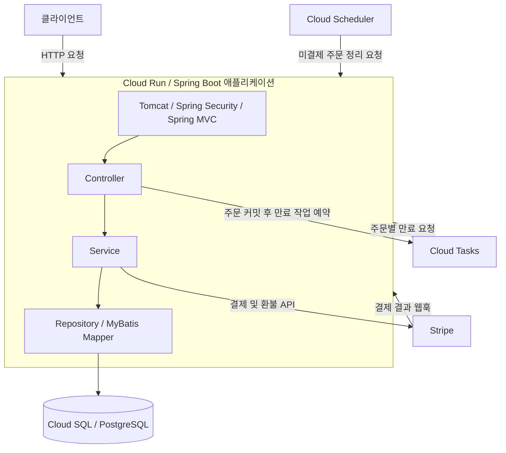

# Book Server

백엔드 개발을 학습하기 위해 만든 온라인 서점 REST API 서버입니다. 회원 가입부터 도서 조회, 장바구니, 주문, 결제와 환불까지 구현하며 데이터 설계, 트랜잭션, 동시성 처리와 배포 과정을 학습했습니다.

- **개발 형태:** 개인 프로젝트
- **담당 범위:** API와 DB 설계, 서버 구현, 테스트, 컨테이너 배포, CI/CD 구성
- **현재 범위:** Cloud Run 배포와 Stripe 샌드박스 연동을 수행한 학습 프로젝트로, 실제 사용자를 대상으로 운영한 경험은 없습니다.

[API 문서 (Swagger UI)](https://hbg1345.github.io/book-server/) · [검색 설계와 평가](docs/book-search-relevance-evaluation.md) · [부하 테스트 안내](LOAD_TEST_GUIDE.md)

## 주요 기능

- **회원과 인증:** 회원 가입, 로그인, 액세스 토큰 발급, 리프레시 토큰 갱신, 사용자와 관리자 권한 구분
- **회원 정보와 주소:** 내 정보 수정, 비밀번호 변경, 배송지 관리
- **도서와 저자:** 도서 목록과 상세 조회, 제목 검색, 관리자용 도서 등록과 수정 및 삭제, 저자 조회와 등록
- **장바구니:** 도서 추가, 수량 변경, 항목 삭제
- **주문:** 주문 생성, 주문 내역 조회, 배송 정보와 주문 당시 가격 보존, 취소와 부분 취소
- **결제:** Stripe 결제 요청, 웹훅을 통한 결제 결과 반영, 환불 요청
- **미결제 주문 정리:** 결제 대기 시간에 따른 만료 처리와 예약 작업 누락을 보완하는 주기적 조회

각 API의 요청과 응답은 [API 문서](https://hbg1345.github.io/book-server/)에서 확인할 수 있습니다. Swagger UI의 요청 대상은 배포된 Cloud Run 주소로 설정되어 있습니다.

## 기술 스택

- **서버와 인증:** Java 17, Spring Boot 4.1.0, Spring MVC, Spring Security, JJWT
- **데이터:** PostgreSQL, MyBatis, Flyway
- **결제와 예약 작업:** Stripe, Google Cloud Tasks, Cloud Scheduler
- **실행과 배포:** Gradle, Docker, Docker Compose, GitHub Actions, Cloud Run, Cloud SQL
- **테스트:** JUnit, Mockito, MockMvc, Testcontainers, Gatling
- **API 문서:** Spring REST Docs, OpenAPI, Swagger UI

## 전체 구조

회원, 도서, 주문, 결제 기능을 하나의 Spring Boot 애플리케이션으로 구성했습니다. 기능별 패키지 안에서 Controller, Service, Repository의 책임을 나누며, Repository 계층의 데이터 접근은 MyBatis Mapper로 구현했습니다.



로컬에서는 Docker Compose로 애플리케이션과 PostgreSQL을 함께 실행합니다. Cloud Tasks는 기본적으로 비활성화되어 있으며, 로컬 실행만으로 Cloud Scheduler 작업이 생성되지는 않습니다.

## 주요 설계와 구현

### 주문과 재고의 동시성 처리

같은 장바구니의 중복 제출을 제어하기 위해 주문 생성 시 장바구니 행을 잠급니다. 재고 차감, 주문과 이력 저장, 배송지 저장, 장바구니 비우기를 하나의 트랜잭션에서 처리합니다.

재고는 구매 수량 이상인 경우에만 차감하는 조건부 UPDATE를 사용합니다. 취소와 만료가 동시에 실행될 때는 현재 주문 행을 잠근 뒤 상태를 다시 확인해 재고가 중복 복원되는 것을 제어합니다.

Testcontainers PostgreSQL을 이용해 재고 경쟁, 같은 장바구니의 중복 주문, 취소와 만료의 동시 실행 등을 검증하는 테스트를 작성했습니다. 이 테스트에서 외부 결제는 대역으로 교체합니다.

- [주문 서비스](src/main/java/com/example/bookserver/purchase/PurchaseService.java)
- [주문 동시성 테스트](src/test/java/com/example/bookserver/purchase/PurchaseConcurrencyTest.java)

### 결제 재요청과 비동기 이벤트 처리

결제 요청에는 주문 UUID로 만든 멱등성 키를 사용하고, 내부 결제 테이블에도 고유 제약을 적용했습니다. 결제 금액은 서버에 저장된 주문 금액으로 결정하며, 웹훅의 서명, 통화, 금액을 확인한 뒤 결제 결과를 반영합니다.

미결제 주문은 Cloud Tasks로 개별 만료 작업을 예약합니다. 주문 저장 후 작업 등록이 실패하는 경우에는 Cloud Scheduler가 호출하는 주기적 조회로 기한이 지난 주문을 다시 찾아 처리합니다.

Stripe 샌드박스에 실제 API 요청을 보내는 계약 테스트는 일반 테스트와 분리했습니다. 테스트 카드 결제와 환불을 확인하는 범위이며, 실제 금액의 청구나 정산을 검증한 결과는 아닙니다.

- [결제 연동 코드](src/main/java/com/example/bookserver/payment)
- [Stripe 샌드박스 계약 테스트](src/test/java/com/example/bookserver/payment/stripe/StripeSandboxContractTest.java)

### 주문의 현재 상태와 변경 이력

`purchase_current`는 주문별 현재 상태를 유지하고, `purchase_history`와 `purchase_book_history`는 상태와 주문 도서의 변경 이력을 저장합니다. 현재 상태 조회와 이력 조회의 목적을 나누고, 이력 추가와 현재 상태 갱신은 같은 트랜잭션에서 수행합니다.

주문 당시 가격과 배송지를 별도로 저장해 도서 가격이나 회원 주소록이 변경되어도 주문 당시 정보를 보존합니다. 스키마와 초기 카탈로그 적재는 Flyway 마이그레이션으로 관리합니다.

- [DB 마이그레이션](src/main/resources/db/migration)

### 도서 검색

PostgreSQL의 부분 일치 검색과 유사도 검색을 조합해 제목 검색을 구현했습니다. 검색 품질 평가와 인덱스별 성능 비교의 조건 및 결과는 [검색 설계와 평가 문서](docs/book-search-relevance-evaluation.md)에 정리했습니다.

## 로컬 실행

### 준비

Docker와 Docker Compose가 필요합니다. Gradle 명령을 호스트에서 실행하려면 JDK 17과 실행 중인 Docker 엔진이 필요합니다.

1. 저장소 루트의 `.env.example`을 `.env`로 복사합니다.
2. `.env`의 `STRIPE_SECRET_KEY`를 Stripe 테스트 모드 키로 설정합니다.
3. 로컬 웹훅을 확인하려면 Stripe CLI에서 아래 명령을 실행하고, 출력되는 서명 키를 `.env`의 `STRIPE_WEBHOOK_SECRET`에 설정합니다.

```bash
stripe listen --forward-to localhost:8080/api/webhooks/stripe
```

설정 항목은 [.env.example](.env.example)을 참고하세요. `.env`는 Git 추적에서 제외되어 있습니다. Stripe 비밀 키가 누락되거나 비어 있으면 애플리케이션이 시작되지 않습니다.

### 실행과 종료

```bash
docker compose up --build
```

- API 주소: `http://localhost:8080`
- PostgreSQL: `localhost:5432` (기본 DB `bookdb`, 사용자 `bookuser`)
- 최초 실행 시 Flyway가 스키마를 구성하고 카탈로그를 적재하므로 시간이 걸릴 수 있습니다.

```bash
docker compose down
```

종료 후에도 DB 볼륨은 유지됩니다. 초기 데이터부터 다시 구성하려면 `docker compose down -v`를 실행할 수 있습니다. 이 명령은 로컬 DB 볼륨과 저장된 데이터를 삭제합니다.

로그인 응답의 액세스 토큰은 보호된 API 호출 시 `Authorization: Bearer <accessToken>` 헤더로 전달합니다. 일반 회원 가입은 `USER` 권한을 부여하며, 도서와 저자 관리용 쓰기 API에는 `ADMIN` 권한이 필요합니다.

## 테스트와 API 문서 생성

### 일반 테스트

```bash
./gradlew test
```

Windows PowerShell에서는 `./gradlew.bat test`를 사용합니다. Testcontainers가 테스트용 PostgreSQL을 실행하며, Flyway로 스키마를 구성합니다. 일반 테스트에서는 대규모 카탈로그 적재를 생략하고 외부 결제 호출을 대역으로 교체합니다.

### Stripe 샌드박스 계약 테스트

```bash
./gradlew contractTest
```

테스트 모드 키와 네트워크 연결이 필요합니다. 이 작업은 `.env`의 설정도 읽으며, 키가 없으면 테스트를 건너뜁니다.

### API 문서 생성

```bash
./gradlew asciidoctor openapi3
```

API 테스트에서 생성한 Spring REST Docs 문서 조각으로 문서를 만들고, OpenAPI 명세를 `build/api-spec/openapi3.yaml`에 생성합니다.

검색 품질 평가, 검색 성능 측정, UUID 벤치마크와 Gatling 부하 테스트는 일반 테스트에서 분리되어 있습니다. 실행 조건은 [검색 평가 문서](docs/book-search-relevance-evaluation.md)와 [부하 테스트 안내](LOAD_TEST_GUIDE.md)를 참고하세요.

## CI/CD

[GitHub Actions 워크플로](.github/workflows/ci.yml)는 `master` 대상 Pull Request와 `master` 변경 시 테스트와 API 문서 생성을 실행합니다. `master`에 반영된 변경은 테스트 성공 후 다음 작업으로 이어집니다.

1. OpenAPI 명세와 Swagger UI를 GitHub Pages에 게시합니다.
2. 애플리케이션 이미지를 빌드해 Artifact Registry에 업로드하고 Cloud Run에 배포합니다.
3. 배포된 서비스의 API를 호출해 Stripe 연결을 확인합니다.

문서 게시와 애플리케이션 배포는 테스트 이후 별도 작업으로 실행됩니다. Google Cloud 접근에는 GitHub OIDC와 Workload Identity Federation을 사용하고, 배포 환경의 비밀 값은 Secret Manager에서 주입합니다.

## 현재 한계와 개선 방향

- **실제 사용자 운영:** 직접 작성한 테스트와 가상 사용자 시나리오를 중심으로 검증했습니다. 실제 사용자의 이용 패턴과 피드백을 바탕으로 개선하는 경험이 필요합니다. 결제 검증은 Stripe 샌드박스 범위입니다.
- **운영 로그와 장애 복구:** 일부 실패 로그와 미결제 주문 재조회는 구현했지만, 장애 감지부터 영향받은 거래의 추적과 복구까지 이어지는 운영 절차는 보완해야 합니다. 요청과 거래를 연결하는 로그, 미완료 작업 기록, 외부 거래와 내부 상태의 대조, 강제 종료 후 복구 테스트를 개선 방향으로 두고 있습니다.
- **배포 검증 단계:** 현재는 자동 테스트를 통과하면 하나의 Cloud Run 서비스로 배포합니다. 별도의 검증 환경에서 DB 변경과 주요 API를 확인한 뒤 운영 환경에 반영하는 단계와 롤백 절차가 필요합니다.
